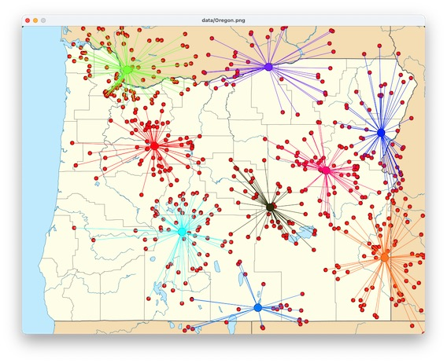

# Cluster of Fire

A Python project that uses k-means clustering to group historical wildfire locations on a map.
I built this for CS 210 at the University of Oregon.

## Wat it does

- Reads in wildfire location data
- Groups the fires into clusters using k-means
- Draws the clusters on a map so you can see where the hot spots are

## What I Learned
- Successive approximation: k-means keeps refining its guess until the clusters stop changing,and this was the first time I used that idea in a real program
- Parallel array: I stored the data in lists that line up by index
- Building in small steps: I tests on tiny data sets first, then scaled up to the full data

## Credits

This project incorporates a fork of John Zelle's `graphics.py` 
module, which carries a GPL license, so this project is necessarily 
also covered by GPL. 

